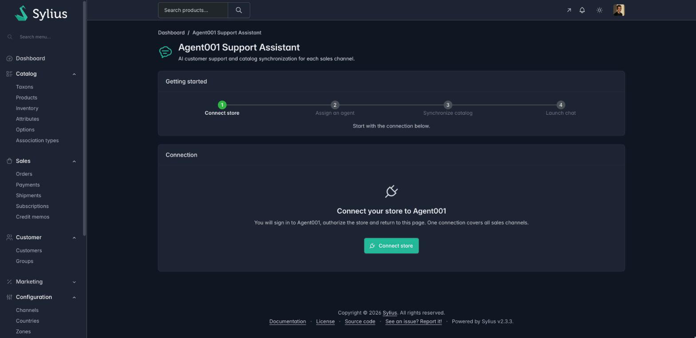
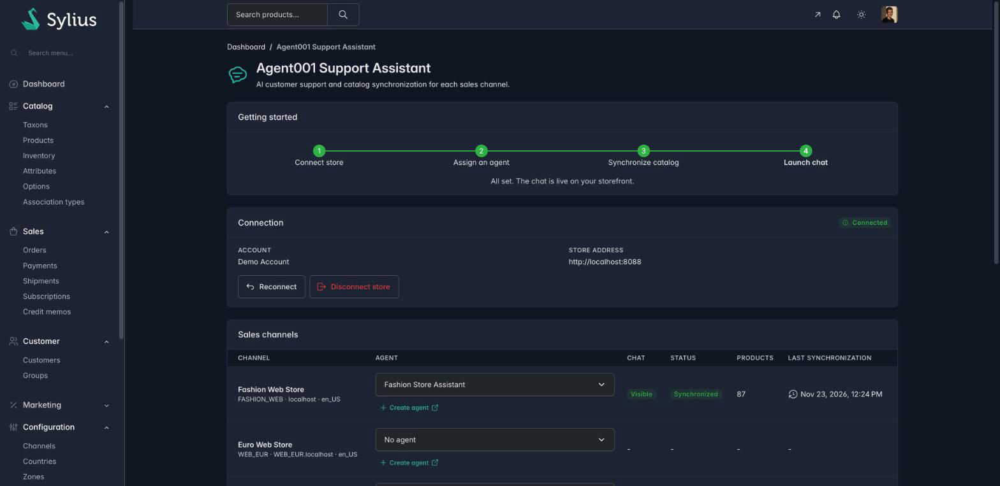
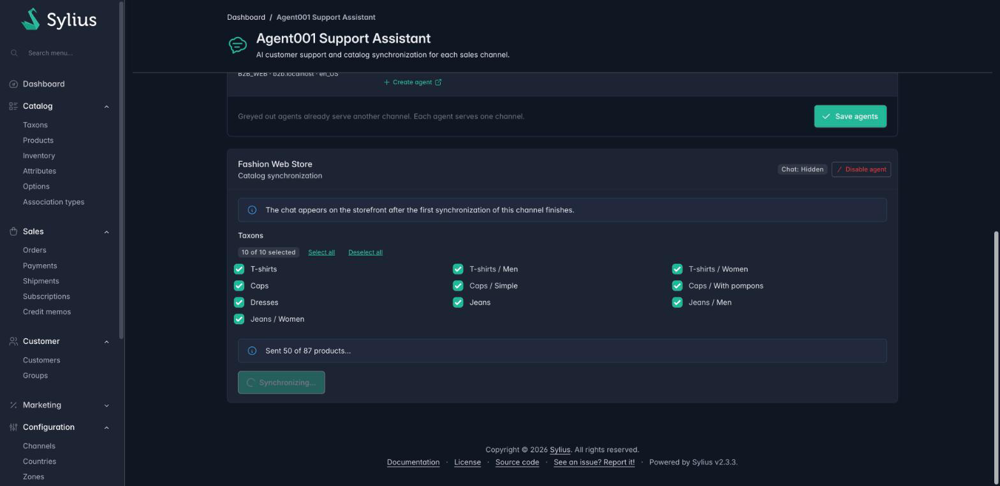
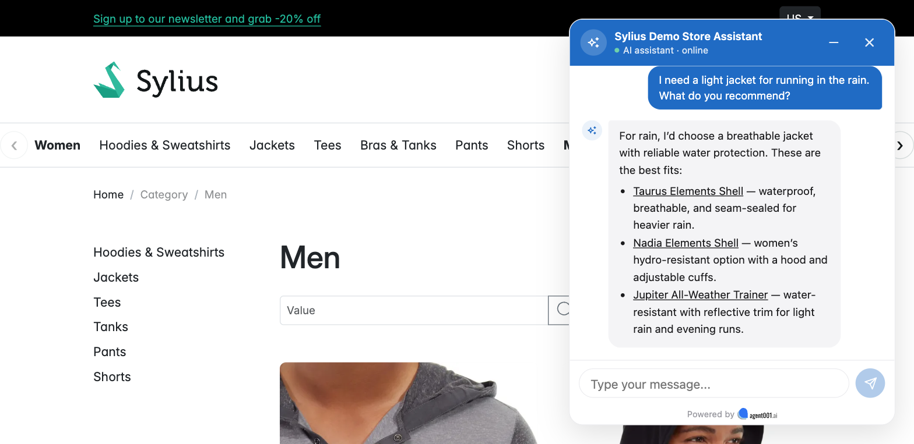

<p align="center"></p>

# Agent001 - Support Assistant for Sylius

Official **Agent001** AI customer-support chat and catalog synchronization plugin for **Sylius 2**.

---

## Features

- **One connection, many sales channels**: The store connects once with [app.agent001.ai](https://app.agent001.ai) (OAuth-like flow, no manual API keys). Every enabled Sylius channel is a separate Agent001 catalog (`channel:<CODE>`, sent in the `X-Channel-Code` header) with its own agent, taxon filter, synchronization and widget key.
- **Agent per channel**: Assign one agent to each channel or leave it without an agent. An agent can serve only one channel. Choosing an agent opens the channel catalog, sends all channel hostnames as store hosts and adds the channel domain to the agent's allowed widget origins. Setting *No agent* removes the channel catalog from Agent001.
- **Taxon filter per channel**: The list shows taxons under the channel menu taxon. Selecting all taxons means no filter, so new taxons are included automatically.
- **Full catalog batch ingestion**: `POST /api/v1/ingest` per channel, with the channel locale, prices (`ChannelPricing`), base currency and URLs on the channel hostname. Taxons and product options are sent as store context, the batch is split when it exceeds 8 MB, catalogs above 50 000 products are rejected, and the plugin follows the indexing session until the backend reports it finished. Out-of-stock products and variants, and products not assigned to the channel, are not sent.
- **Real-time catalog sync**: Product and variant changes are sent to every channel with an agent (`PUT|DELETE /api/v1/ingest/products/{id}`) through **Symfony Messenger**. A product removed from a channel is deleted from that channel catalog.
- **Storefront chat widget**: Injected through **Twig Hooks** for the current channel. It appears after the first synchronization of the channel finishes and while the agent is enabled.
- **Privacy-safe order status lookup**: REST API at `/agent001/v1/orders/{order_number}` called by the widget and by the Agent001 backend. Send the email in a JSON `POST` body (`{"email": "..."}`); `GET ?email=` is still accepted.
  - Requires the customer's checkout email matching the order.
  - The channel widget key finds only orders of its channel; the connection API key finds orders of all channels.
  - Returns order status, dates, totals, shipping method, tracking numbers with carrier links, and line items.
  - Excludes customer name, street address, phone number, and payment credentials.
  - Widget requests are limited to 10 per minute per IP, and blocked for an hour after 5 failed lookups of the same email or order number from one IP (and after 50 failed lookups of one email from any IP). CORS allows the store origin, the Agent001 origin and `agent001_sylius_ai_assistant.allowed_origins`. Responses are sent with `Cache-Control: no-store`.

---

## Screenshots

| Connection | Sales channels and agents |
|---|---|
|  |  |

| Catalog synchronization | Storefront chat widget |
|---|---|
|  |  |

---

## Requirements

- PHP `^8.2`
- Sylius `~2.2.13 || ^2.3.3`
- Symfony `^6.4` or `^7.4`

Sylius 2.3 itself requires PHP 8.3 or newer. Every Sylius line is tested in CI with Symfony 6.4 and 7.4.

The database is tested in CI on MySQL 8.0. The plugin migrations are written with the Doctrine schema API and contain no MySQL-specific SQL, but other database platforms are not tested.

---

## Installation

### 1. Require the Plugin via Composer

```bash
composer require agent001/sylius-ai-assistant-plugin
```

### 2. Register the Bundle

Symfony Flex adds the bundle to `config/bundles.php` during `composer require`. Check that the line below is there and add it if it is missing (for example when Flex is not used):

```php
return [
    // ...
    Agent001\SyliusAiAssistantPlugin\Agent001SyliusAiAssistantPlugin::class => ['all' => true],
];
```

### 3. Import Routing

Add the plugin routes to your `config/routes.yaml`:

```yaml
agent001_sylius_ai_assistant:
    resource: "@Agent001SyliusAiAssistantPlugin/config/routes.yaml"
```

The admin pages (including the connection callback) are imported under the Sylius admin path, `/%sylius_admin.path_name%` (`SYLIUS_ADMIN_ROUTING_PATH_NAME`, `admin` by default), so they stay behind the admin firewall when the admin path is changed. The order lookup API is served at `/agent001/v1/orders/{order_number}`.

The plugin configuration (rate limiters and Twig hooks) is registered automatically, no configuration file has to be imported.

### 4. Run Plugin Migrations

The plugin ships its own migrations, nothing has to be generated. Execute them:

```bash
bin/console doctrine:migrations:migrate
```

### 5. Install Assets

The settings page loads its script and stylesheet from `public/bundles/agent001syliusaiassistantplugin`. Symfony Flex installs them on `composer require`; otherwise run:

```bash
bin/console assets:install
```

### 6. Configure Messenger

Route the plugin messages to an async transport that supports delayed messages (Doctrine, Redis or AMQP, for example the `main` transport of Sylius-Standard) in `config/packages/messenger.yaml`:

```yaml
framework:
    messenger:
        routing:
            Agent001\SyliusAiAssistantPlugin\Message\SyncCatalogMessage: main
            Agent001\SyliusAiAssistantPlugin\Message\SyncProductMessage: main
            Agent001\SyliusAiAssistantPlugin\Message\CheckSyncSessionMessage: main
```

Run a worker for this transport permanently (for example with Supervisor or systemd):

```bash
bin/console messenger:consume main
```

Do not skip this step. Without the routing every change of a product or its stock, also when a customer places an order, calls Agent001 during the request, and the full synchronization started in the admin panel runs inside the admin request. The end of the catalog indexing is then not detected automatically either: the widget appears only after the next nightly synchronization or after the admin panel is opened.

---

## Configuration

1. In the Sylius Admin Panel, open **Configuration → Agent001 Assistant**.
2. Click **Connect store** and authorize the store. The connection covers all channels.
3. In **Sales channels**, assign an agent to each channel that should have the chat and click **Save agents**. The first synchronization of each channel is queued automatically.
4. (Optional) In the channel section, choose the taxons to synchronize and click **Synchronize catalog**.
5. Check the widget on each channel storefront.

Set the channel **hostname** in Sylius for every channel served on its own domain. The hostname defines the channel address sent to Agent001, the product URLs and the allowed widget domain. A channel without a hostname uses the address of the admin panel.

**Disconnect store** removes the connection (`DELETE /api/v1/integrations/me`) and the settings of all channels. The Agent001 account stays unchanged.

### Plugin options

All options are optional; without a configuration file the plugin talks to `https://app.agent001.ai`. A full example:

```yaml
# config/packages/agent001_sylius_ai_assistant.yaml
agent001_sylius_ai_assistant:
    base_url: 'https://app.agent001.ai'
    allowed_origins:
        - 'https://www.example.com'
```

| Option | Default | Description |
|---|---|---|
| `base_url` | `https://app.agent001.ai` | Public Agent001 address used for the connect flow, links in the admin panel and the chat widget loader. |
| `api_base_url` | `null` (uses `base_url`) | Address used for server-to-server API calls, for example an internal hostname of Agent001 reachable only from the store servers. It must use `https` like `base_url`. |
| `allowed_origins` | `[]` | Extra origins allowed by CORS on the order lookup endpoint. |

Both addresses must use `https`. Plain `http` is accepted only for `localhost`, `127.0.0.1`, `[::1]` and `*.localhost`. A literal value that breaks this rule fails the container compilation. A value read from an environment variable is checked when it is used: the plugin sends no API request to such an address and does not render the widget.

#### Environment variables

The plugin reads no environment variables by itself. To take the addresses from the environment, reference the variables in the configuration and give them a default, so that a missing variable does not break the store:

```yaml
# config/packages/agent001_sylius_ai_assistant.yaml
parameters:
    agent001_base_url: 'https://app.agent001.ai'

agent001_sylius_ai_assistant:
    base_url: '%env(default:agent001_base_url:AGENT001_BASE_URL)%'
    api_base_url: '%env(default::AGENT001_INTERNAL_BASE_URL)%'
```

| Variable | Used for | When it is not set |
|---|---|---|
| `AGENT001_BASE_URL` | `base_url` | The `agent001_base_url` parameter is used. |
| `AGENT001_INTERNAL_BASE_URL` | `api_base_url` | `base_url` is used for the API calls. |

Without a default, for example `%env(AGENT001_BASE_URL)%`, the variable has to be defined in `.env` (or the server environment) with a valid address, otherwise the storefront pages fail.

#### CORS

The order lookup endpoint (`/agent001/v1/orders/{order_number}`) answers CORS requests from these origins only:

- the origin of the store request (the channel domain),
- the origin of `base_url`,
- every origin listed in `allowed_origins`.

Allowed origins receive `Access-Control-Allow-Origin` with the request origin, the methods `GET, POST, OPTIONS`, the headers `X-Agent001-Auth, Content-Type, Accept` and a preflight cache of one day. Requests from other origins get no CORS headers, so browsers block them. Add an origin to `allowed_origins` only when the widget is embedded on a domain that is not a Sylius channel hostname.

---

## Messenger and CLI

Product changes, agent assignment and the **Synchronize catalog** button dispatch `Agent001\SyliusAiAssistantPlugin\Message\SyncProductMessage` and `Agent001\SyliusAiAssistantPlugin\Message\SyncCatalogMessage`.

Product changes are detected on Doctrine flush, so changes made through the admin panel, the API, imports and custom code are all synchronized. A change of a product, its translations, variants, channel prices, images or taxons (including stock updates on orders) dispatches one `SyncProductMessage` per product; removing a product sends it as a deletion. Changes are collected over all flushes of a request, console command or handled worker message and dispatched once at its end (`kernel.terminate`, `console.terminate`, worker message handled or failed), so a product saved several times is sent only once. If the process dies after the flush but before that end (fatal error, out of memory, kill, timeout), the change is not sent until the nightly synchronization.

After the last batch of a full synchronization the backend indexes the catalog. The worker follows the indexing session with `Agent001\SyliusAiAssistantPlugin\Message\CheckSyncSessionMessage`, dispatched with a 5 second delay until the session succeeds, fails or times out after 2 hours, so the widget appears without visiting the admin panel. The check is dispatched only when the message is routed to an async transport; otherwise the status is refreshed by the admin panel and by `agent001:sync`.

The plugin registers its own message bus, `agent001_sylius_ai_assistant.command_bus`, and dispatches and handles its messages only there. The bus has no `doctrine_transaction` middleware (unlike `sylius.command_bus`), so the synchronization progress shown in the admin panel is saved while the catalog is being sent. No configuration of the bus is needed.

The routing of the messages to an async transport is described in [Installation, step 6](#6-configure-messenger). A product message that fails while it is handled synchronously is logged as an error with the product ID and does not break saving the product; the nightly synchronization sends the change.

The catalog should also be synchronized once a day to pick up changes that bypass Doctrine flush (direct SQL, bulk DQL updates). Schedule the command every hour:

```bash
0 * * * * cd /path/to/shop && bin/console agent001:sync --due
```

With `--due` each channel is queued once a day, at a channel-specific time between 1:00 and 5:00 (server time). Without it every channel with an agent is queued immediately:

```bash
bin/console agent001:sync
bin/console agent001:sync --channel=FASHION_WEB
```

---

## Uninstall

1. Disconnect the store: in the admin panel open **Configuration → Agent001 Assistant** and click **Disconnect store**. The plugin ends the integration at Agent001 and removes the API key and the channel settings, so the widget disappears. From now on the queued plugin messages are processed without calling Agent001.
2. Remove the cron entry running `bin/console agent001:sync --due`.
3. Remove the routing of the plugin messages (`Agent001\SyliusAiAssistantPlugin\Message\*`) from the Messenger configuration and deploy it, so no new plugin message is queued. Keep the worker running until the queued plugin messages are processed. `bin/console messenger:stats` counts all messages of the transport, including the Sylius ones, so with the Doctrine transport check the plugin messages directly (`default` is the queue of the Sylius `main` transport); the query returns `0` when none is left:

    ```bash
    bin/console dbal:run-sql "SELECT COUNT(*) FROM messenger_messages WHERE queue_name = 'default' AND body LIKE '%Agent001%'"
    ```

    Then remove the plugin messages from the failure transport of the transport they were routed to. Sylius-Standard defines no global `failure_transport`; its `main` transport uses `main_failed`, so pass it with `--transport`. `--stats` shows the message count by class, `--class-filter` lists the messages of one plugin class (repeat it for `SyncCatalogMessage` and `CheckSyncSessionMessage`), and `messenger:failed:remove` takes their IDs:

    ```bash
    bin/console messenger:failed:show --transport=main_failed --stats
    bin/console messenger:failed:show --transport=main_failed --class-filter='Agent001\SyliusAiAssistantPlugin\Message\SyncProductMessage'
    bin/console messenger:failed:remove <id> [<id>...] --transport=main_failed --force
    ```

    No plugin message is left when `--stats` lists no `Agent001\SyliusAiAssistantPlugin\Message\*` class and, with the Doctrine transport, `bin/console dbal:run-sql "SELECT COUNT(*) FROM messenger_messages WHERE body LIKE '%Agent001%'"` returns `0`.

4. Remove the `agent001_sylius_ai_assistant` routing import from `config/routes.yaml` and the `agent001_sylius_ai_assistant` configuration, if you added any.
5. Remove the package. Symfony Flex removes the bundle from `config/bundles.php`; without Flex remove the line yourself:

    ```bash
    composer remove agent001/sylius-ai-assistant-plugin
    ```

    With `--no-scripts` Composer does not clear the cache, and every `bin/console` command, including `cache:clear`, fails on the removed classes (without debug the compiled container is not checked for freshness). Right after this step delete the cache directory of the environment (`var/cache/<env>`, e.g. `var/cache/prod`) and then clear the cache:

    ```bash
    rm -rf var/cache/prod
    bin/console cache:clear
    ```

6. Remove the plugin tables and its migration versions (`sylius_migrations` is the migrations table of Sylius-Standard, use the table configured in `doctrine_migrations.storage.table_storage.table_name`):

    ```bash
    bin/console dbal:run-sql "DROP TABLE agent001_setting, agent001_connection"
    bin/console dbal:run-sql "DELETE FROM sylius_migrations WHERE version LIKE 'Agent001%'"
    ```

7. Clear the cache and reinstall the assets, which removes the plugin assets from `public/bundles`:

    ```bash
    bin/console cache:clear
    bin/console assets:install
    ```

---

## Development

The repository includes the official Sylius TestApplication layout. After installing dependencies, initialize it with:

```bash
composer test-app-init
```

Run the tests:

```bash
vendor/bin/phpunit
vendor/bin/phpunit --testsuite Functional
vendor/bin/behat
```

The `Functional` suite and the Behat scenarios in `features/` need the database configured by `DATABASE_URL` with the migrations executed.

---

## Changelog

See [CHANGELOG.md](CHANGELOG.md).

---

## License

This plugin is open-source software licensed under the [MIT license](LICENSE).
